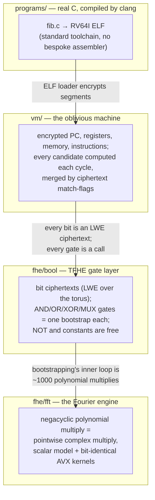

# frost-vm

A Fully Homomorphic Encryption virtual machine in Go: it runs RV64I
programs — compiled from real C with clang — *obliviously*. The program,
the instruction pointer, the registers and the data memory are all
ciphertexts, and the machine never looks at any of them: every cycle every
instruction is applied to every slot and the results are selected by
homomorphic multiplexing. This is real TFHE, not a simulation — every
logic gate is a bootstrapped FHE operation, and every layer below is
implemented here from first principles.

## Project structure

Each layer only sees the interface of the one below it. The source layout
mirrors the diagram; every source file opens with a summary comment
describing what it implements and the invariants it maintains.

## Where to look

| topic | document |
|---|---|
| The cryptography: torus encoding, LWE/TLWE/TGSW, keyswitch, the bootstrap pipeline, the 14-gate set, parameters & noise budget | [docs/fhe-bool.md](docs/fhe-bool.md) |
| The Fourier engine: LagrangeHalfC representation, packed real-input FFT, scalar model + bit-identical AVX kernels | [docs/fhe-fft.md](docs/fhe-fft.md) |
| The machine: the oblivious cycle, masked-OR decode, full RV64I coverage (42/42), load/store semantics, cost model, encoding pitfalls | [docs/vm-machine.md](docs/vm-machine.md) |
| Real C programs: clang flags and why, linker layout, the ELF loader, how to add a program | [docs/toolchain.md](docs/toolchain.md) |
| Status, verification strategy, reproducibility (pinned docker), honest costs, roadmap | [docs/verification.md](docs/verification.md) |

## Quickstart

    go build ./... && go test ./...          # full suite (~50 min of real TFHE)
    docker build --pull -t frost-vm .        # same suite in the pinned image
    FROST_RUN_FIB=1 go test ./vm/ -run TestFibonacciProgram   # end-to-end demo (~33 min)

License: BSD-2-Clause with the nuclear-facility exclusion clause — see
[LICENSE](LICENSE).
