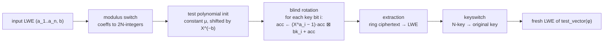

# The gate layer — `fhe/bool` (TFHE over the torus)

This package implements the cryptosystem: ciphertexts of single bits, and
gates that compute on them without the secret key. Everything above it (the
VM) only ever sees `EncryptBit`, `DecryptBit`, and the gate calls.

## The torus and how a bit is encoded

Plaintexts live on the **torus** T = R/Z: the interval [0,1) with wraparound
addition. Concretely a "phase" is an `int32` representing `v / 2^32 mod 1`
(Torus32); adding phases is int32 addition, which wraps mod 2^32 = mod 1 on
the torus.

A bit is encoded as one of two torus points, ±1/8 of the way around:

    true  → +1/8   (Torus32 0x20000000)
    false → −1/8   (Torus32 0xE0000000)

A ciphertext's phase is the encoded point **plus a small error** e (drawn
from a discrete Gaussian, stddev ~2^-15 of the torus at test parameters).
Decryption recovers the bit by asking which of the two points the phase is
closer to. The scheme works as long as errors stay below the decision
boundary at 0 — the whole design of every operation below is about keeping
errors there.

The conversion helpers are exact, not approximate: `phaseToT32(num, denom)`
computes `num/denom mod 1` by taking the remainder in the signed domain
first (reducing the unsigned value first would only be exact when the
denominator divides 2^32); `dtot32(d)` strips the integral part *before*
scaling by 2^32 (scaling the whole value loses precision once d·2^32 leaves
the exact range of float64/int64). Both are pinned against the reference
implementations' exact semantics, not just their behavior on inputs the
call sites happen to produce.

## LWE: the ciphertext

An LWE sample under a secret key s ∈ {0,1}^n is a vector (a_1..a_n, b) of
torus elements. Its **phase** is

    φ = b − Σ a_i·s_i   (mod 1)

and it encrypts message μ when φ = μ + e for a small e. The a_i are uniform
and public; all the structure is hidden in the inner product with the
binary key. Decrypting means computing the phase (cheap, with the key) and
rounding to the nearest message point.

Key facts the rest of the design leans on:

- **Linear combinations are free.** Adding two ciphertexts, negating one, or
  adding a known constant changes the phase by the corresponding amount and
  *does not grow the error meaningfully*. No keys, no transforms — just
  vector arithmetic. We call samples with zero mask (`a_i = 0`) **trivial**
  ciphertexts: they hold a known plaintext with zero noise.
- **The error never shrinks on its own.** Every gate adds noise, and
  chains of plain linear operations accumulate it. Left alone, a chain of a
  few thousand gates would overflow the decision boundary. This is the
  entire reason bootstrapping exists.

## Bootstrap: the noise refresh

Bootstrap is one operation, `bootstrap(x, test_vector) → x'`, that takes a
noisy ciphertext of phase φ and returns a *fresh* ciphertext of the same
plaintext whose error depends only on the bootstrap parameters — not on the
input's error (as long as the input error was below the threshold). It is
the only noise-removing operation in the scheme, hence every non-free gate
is exactly one bootstrap.

Mechanically, bootstrap computes a **function of the phase**: the output is
an encryption of `test_vector(φ)`, where the test vector is a step function
on the torus chosen to implement the desired gate. The pipeline:

Step by step, exactly as implemented in `bootstrap.go`:

1. **Modulus switch.** The input coefficients (torus elements) are rounded
   to integers mod 2N (`modSwitchFromTorus32(x, 2N)`). These integers say
   *how far to rotate* in the next step; quantizing the rotation amount to
   2N possibilities is what keeps the ring size fixed.
2. **Test polynomial.** The accumulator starts as a trivial ring
   ciphertext whose polynomial is the constant μ (the test vector: a single
   tap of height μ = 1/8 at X^0), pre-rotated by X^(2N−b) using the
   switched body coefficient.
3. **Blind rotation.** For each key bit position i:
   `acc ← (X^{a_i} − 1)·acc ⊠ bk_i + acc`, where bk_i is a TGSW ciphertext
   encrypting the secret key bit s_i (below), `⊠` is the external product,
   and the ring multiplications by X^{a_i} and X^{a_i}−1 are the free
   rotations from the FFT package. After all n steps, the accumulator
   polynomial is the test vector **rotated by the encrypted phase**
   φ = b − Σ a_i s_i — the rotation amount is encrypted, and no one but a
   key-holder knows where the tap landed. Multiplication by X^a is an
   isometry of the ring, so noise grows only additively across the n steps
   (~√n · external-product noise), never multiplicatively.
4. **Extraction.** The accumulator is a ciphertext of a *polynomial*
   (TLWE). Reading coefficient 0 turns it into an ordinary LWE sample:
   a[0] = x.a[0][0], a[j] = −x.a[0][N−j] for j ≥ 1, b = x.b[0]. The
   extracted phase is the value of the rotated test vector at 0 — i.e.
   test_vector(φ).
5. **Keyswitch.** Extraction produced an LWE under the *ring* key (size N).
   KeySwitch re-encodes it under the original size-n key.

The cost is n external products of two N-coefficient polynomials each —
which is where the Fourier engine comes in: each external product's ring
multiplications are N/2 pointwise complex multiplies via LagrangeHalfC.

### KeySwitch, concretely

KeySwitch answers: given an LWE under key s_in, produce an LWE under key
s_out with the same plaintext. It works by *decrypting homomorphically*:
for each input coefficient, decompose it into **signed digits** in a base
Bg (the `decompH` step: add a rounding offset 2^(31−l·b) so digits land
centered around zero, then extract l digits by shift+mask; digit 0 is
skipped because the corresponding key entry is a trivial zero sample), and
for each nonzero digit, add `digit × (a precomputed encryption of
s_out[j] under s_in)`. The key material is generated once: l levels × n
entries of LWE samples, with the noise **recentered** (the whole noise
vector is drawn in float64, its mean subtracted, then converted to Torus32
— both reference implementations do this; per-sample encryption noise, by
contrast, is never centered).

The decomposition is the noise-control knob: digits are ~1/Bg of the
original coefficient, so the key-encryption noise enters scaled down by
Bg^l; the trade is more key material and more additions.

### TLWE and TGSW: the ring-side objects

- **TLWE** (k=1): an LWE whose elements are *polynomials* in
  Z[X]/(X^N+1) with Torus32 coefficients, under a binary polynomial key;
  phase polynomial b(X) − a(X)·s(X).
- **TGSW**: an l×2 matrix of TLWEs encoding a *polynomial message* m(X)
  with a **diagonal convention**: the message of row (bloc, j) lives in
  polynomial block bloc, scaled by the gadget — *not* always in the body
  column. (Getting this convention wrong is a classic trap: an external
  product built with messages in the body computes m·(a+b) instead of
  m·(b − a·s), and the result only looks random when the accumulator mask
  is nonzero — trivial-mask toy tests still pass, misleadingly green.)
- **Bootstrap key**: n TGSW samples, one encrypting each bit of the LWE
  secret key under the TLWE key. Generated once per key pair.
- **External product** `TLWE ⊠ TGSW`: decompose the TLWE's coefficients
  into the same signed digits, multiply each digit-polynomial against the
  matching TGSW row-polynomial **in the Fourier domain** (transform once
  per row, reuse across the l·2 blocks), and sum. The result is a TLWE
  encrypting the product of the two messages. This is the hot loop:
  at n=500, one bootstrap = 500 external products ≈ 500·2·l polynomial
  multiplications at N=1024.

## Gates: one bootstrap each, with the truth table in the test vector

Here is the trick that makes boolean logic cheap. With the ±1/8 encoding,
*adding two ciphertexts adds their phases*, so a+b's phase sits at one of
four points: {−1/4, 0, +1/4, +1/2} for the four input bit pairs. A step
function on the torus can map each of those four regions to any desired
output point — i.e. **any binary truth table is a function of the phase
sum**, and bootstrap computes functions of the phase.

So every binary gate is: one free linear combination + one bootstrap. The
linear combination positions the four phase points so the test vector's
step lands correctly. Exactly as implemented (`gates.go`), with μ = 1/8:

| gate | free pre-combination | then |
|---|---|---|
| AND | (0, −1/8) + a + b | bootstrap μ=1/8 |
| NAND | (0, +1/8) − a − b | bootstrap μ=1/8 |
| OR | (0, +1/8) + a + b | bootstrap μ=1/8 |
| NOR | (0, −1/8) − a − b | bootstrap μ=1/8 |
| XOR | (0, +1/4) + 2a + 2b | bootstrap μ=1/8 |
| XNOR | (0, −1/4) − 2a − 2b | bootstrap μ=1/8 |
| ANDNY (¬a∧b) | (0, −1/8) − a + b | bootstrap μ=1/8 |
| ANDYN (a∧¬b) | (0, −1/8) + a − b | bootstrap μ=1/8 |
| ORNY (¬a∨b) | (0, +1/8) − a + b | bootstrap μ=1/8 |
| ORYN (a∨¬b) | (0, +1/8) + a − b | bootstrap μ=1/8 |

(XOR doubles the inputs and offsets by 1/4 so the four phase points land
at {−1/2, 0, 0, +1/2} → the bootstrap's step separates equal from
different.)

Two more operations cost nothing:

- **NOT** is ciphertext negation: −(a,b) has phase −φ, and −(+1/8) = −1/8.
  Free, no bootstrap.
- **CONSTANT** is a trivial ciphertext of ±1/8: zero noise, no key.

**MUX** (mux(sel, b, c) = b if sel else c) is the one composite: two
bootstraps *without* keyswitch (AND(sel,b) and AND(¬sel,c), each into the
extracted key space), one free addition plus a +1/8 constant, and a single
final keyswitch. Two bootstraps + one keyswitch ≈ 4.5x an AND gate's cost
— which is why the VM's data paths are built from AND/OR chains wherever
possible (see vm-machine.md).

The gate contract, enforced by convention throughout: every gate input must
be an EncryptBit output or another gate output — i.e. a ±1/8 message with
noise below 1/16 of the torus. Inputs outside that space may decrypt to the
wrong bit; the VM maintains the invariant by construction.

## Parameters and noise budget

| | production (DefaultParams) | tests (TestParams) |
|---|---|---|
| ring degree N | 1024 | 1024 (kept!) |
| LWE dimension n | 500 | 64 |
| bootstrap decomposition | l=2, Bg=2^10 | same |
| keyswitch decomposition | l'=8, Bg'=2 | same |
| KS noise stddev | ~2^-15·√(2/π) | same |
| bootstrap noise stddev | 9e-9·√(2/π) | same |

TestParams deliberately keeps the production polynomial degree and shrinks
only the LWE dimension: the noise budget of a bootstrap depends on N (the
ring), not on n (n only multiplies the *number* of external products). So
the small-n test suite exercises the real noise regime at ~1s per gate
suite. The full production set is the classical TFHE boolean parameter set,
in the ~100–130-bit security regime per the standard lattice estimator.

Bootstrapping is probabilistic: with overwhelming probability the output is
correct, and "overwhelming" is parameter-dependent. At production parameters
the failure probability per gate is negligible (~2^-100s); at TestParams it
is small but not astronomically so — a suite running ~10^5 gates can in
principle see a flip. (The fibonacci run's wrong values were *not* this:
they were a deterministic bug, diagnosed by fitting the wrong values
against broken-path hypotheses — see vm-machine.md.)

## Files

| file | contents |
|---|---|
| `params.go` | parameter sets, derived decomposition constants (h, offset, mask) |
| `torus.go` | Torus32 helpers: phaseToT32, dtot32, modSwitchFromTorus32, bool↔phase |
| `noise.go` | discrete Gaussian/uniform sampling, recentered keysets |
| `lwe.go` | LWE samples/keys, encrypt/decrypt, linear ops, KeySwitch + decompH |
| `tlwe.go` | TLWE samples, trivial ring ciphertexts, extraction |
| `tgsw.go` | TGSW samples (FFT-resident), bootstrap keys, diagonal message encoding |
| `bootstrap.go` | blind rotate + extract + keyswitch; external product driver |
| `gates.go` | the Context (keys + gate API), the 14-gate set |
