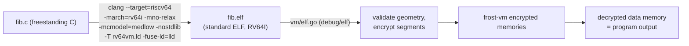

# Real C programs — `programs/` and the ELF loader

The machine executes RV64I encodings, and RV64I encodings are what a real
compiler emits. So there is no bespoke assembler and no custom program
format: programs are written in C, compiled with clang, and loaded from
standard ELF files.

## The toolchain

`programs/build.sh` runs, for every `.c` in the directory:

    clang --target=riscv64-unknown-elf \
        -march=rv64i -mabi=lp64 -mcmodel=medlow -mno-relax \
        -nostdlib -nostartfiles -O2 \
        -fuse-ld=lld -Wl,--no-relax \
        -T rv64vm.ld -o prog.elf prog.c

Why each flag:

- `--target=riscv64-unknown-elf` — bare-metal RV64, no OS ABI.
- `-march=rv64i` — base integer ISA only. The machine implements exactly
  RV64I (no M/A/F/D); the compiler is told, so it cannot emit an
  instruction the VM would treat as unknown. (With `-march=rv64gc`, clang
  helpfully turns `x % y` into a single rem instruction — and the VM would
  silently no-op it.)
- `-mcmodel=medlow` — absolute addressing via LUI+ADDI/LW offsets. The
  loader maps addresses directly; no PC-relative (AUIPC-heavy) codegen to
  reason about.
- `-mno-relax` (both compiler and linker) — linker relaxation rewrites
  instruction sequences and merges GP-relative accesses; we want the plain
  LUI-based sequences the loader and the tests pin.
- `-nostdlib -nostartfiles` — no libc, no crt0; `_start` is the program.
- `-fuse-ld=lld` — the host GNU ld has no riscv emulation; lld does.
- `-O2` — the compiler still optimizes; what it must not do is constant
  fold the whole program away (see `volatile` below).

`rv64vm.ld` places `.text` at byte address 0 and `.data/.bss` at 0x1000.
That second choice is deliberate: the VM masks data addresses to its memory
size (`mem[vaddr & (nMem−1)]`), and 0x1000 is congruent to 0 modulo every
power-of-two memory size in use, so the linker's data segment maps onto
memory offset 0 for any machine geometry. `.text` at 0 means instruction
slot = vaddr/4 directly.

## The program

`fib.c` is freestanding C:

    volatile u32 fib[20];
    void _start(void) {
        fib[0] = 0; fib[1] = 1;
        for (unsigned i = 2; i < 3; i++)
            fib[i] = fib[i-1] + fib[i-2];
        halt();               // __asm__ volatile("ecall")
    }

- `fib` is `volatile` so the stores/loads through memory are real — the
  compiler may not constant-fold the sequence away. (It still unrolls the
  3-iteration loop into straight-line LW/LW/ADD/SW; that is fine — the
  machine executes whatever valid RV64I it is given. The earlier 20-value
  version kept a real loop with a taken BNE, and that run is what
  validated the branch path and exposed the load-extension bug.)
- `halt()` is an inline-asm ECALL: the VM's halt instruction. The infinite
  nop loop after it is unreachable on the VM (the machine freezes at the
  halt flag) but keeps the compiler from falling through.

At the time of writing clang emits 10 real instructions for this program
(LUI, LI, SW, MV, SW, LW, LW, ADD, SW, ECALL) — no stack use, registers
up to a2.

## The loader (`vm/elf.go`)

Uses stdlib `debug/elf`. Steps:

1. **Validate**: ELF64, EM_RISCV, class/endianness; every PT_LOAD segment
   fits the machine geometry (text within nProg slots, data within nMem
   bytes after masking); entry point inside .text.
2. **Size the register file**: scan the instruction words for the highest
   register index used. The scan must be *format-aware*: the rd/rs1/rs2
   fields overlap immediate bits in other formats, and a naive 5-bit-field
   scan over every word reports phantom registers (it found a spurious
   x31 from immediate bits in an otherwise x0..x13 program). The loader
   decodes each word's opcode and reads only the fields that format
   actually has.
3. **Encrypt into place**: each instruction word becomes an encrypted
   Instruction in program slot vaddr/4; each data byte becomes 8 encrypted
   bits in mem[vaddr & (nMem−1)] (zero-initialized elsewhere). The ELF
   symbol table is used to locate the data array for the test's
   decryption step.

`TestLoadELF` asserts the loader round-trips the *exact* encodings clang
emitted (specific instruction words at specific slots), so any toolchain
change that alters codegen shows up as a pin failure with the diff, not as
a mysterious wrong-value run hours later.

## Running it end-to-end

`vm/fib_test.go` (gated behind `FROST_RUN_FIB=1`, since it is ~33 min of
real TFHE): load the ELF, `Run(50)` — the machine self-halts via ECALL
after 10 cycles — then decrypt data memory and assert
fib[0..2] = 0, 1, 1 with the rest of the array still zero. The progress
log (`frost-vm: N cycles executed (pc=...)`) streams to stderr every 10
cycles for long runs.

## Adding a program

1. Drop `foo.c` in `programs/` (freestanding, `_start`, ECALL to halt).
2. `./build.sh` — it prints the disassembly; check it stays inside RV64I
   and the register budget you intend to give the machine.
3. Write a test: `NewRVMachine(...)` sized to the program, `LoadELF`,
   `Run(bound)`, decrypt and assert.
