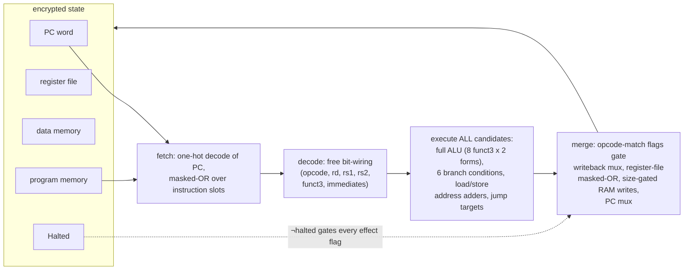

# The oblivious machine — `vm/`

The point of this project: run a *normal* RV64I program — compiled from C,
instruction encodings untouched — where the program counter, the
instructions themselves, all 64-bit registers, and all of data memory are
FHE ciphertexts, and the execution trace leaks nothing.

## Why "oblivious", and what it costs

A normal VM reads the PC, fetches one instruction, and branches. If the
state is encrypted, the VM *cannot* look: any observation of the PC or of
which branch was taken leaks the control flow, which is exactly what FHE
execution is supposed to hide. So the machine never inspects anything.
Every cycle it:

1. reads *every* program slot and selects one (homomorphically),
2. computes *every* candidate instruction's effect on *every* register and
   memory cell,
3. merges the candidates with homomorphic multiplexing, gated by match
   flags that are themselves ciphertexts.

The work per cycle is therefore independent of what the program is doing —
a fixed cost proportional to the machine's size (nProg + nRegs + nMem).
That is the honest price of not looking.

## Words: encrypted multi-bit values

`word.go` builds 64-bit (or parameterized-width) encrypted words out of the
boolean gate layer: a Word is 64 LWE ciphertexts, one per bit,
little-endian (bit 0 = LSB, which keeps adders and shifters direct).

- **Adders/subtractors**: ripple-carry over the bits. Carry logic per bit:
  `carry' = (a∧b) ∨ (carry ∧ (a⊕b))` — 2 ANDs, 1 XOR, 1 OR per bit.
  Subtraction is add-with-negated-second-operand plus inverted carry-in.
- **Comparators**: the subtractor's borrow-out gives signed/unsigned less
  than; equality is an AND of NORs over all bit-pairs (constant-bit
  comparisons — comparing against a plaintext constant — cost only NOT+AND
  per bit, since NOT is free).
- **Barrel shifters** (SLL/SRL/SRA): 6 levels of two-way muxes (one per
  shamt bit), only consulting shamt bits below log2(width) — the same
  masking RV64 itself specifies. SRA fills with the sign bit; the sign
  fill costs nothing extra because muxes select between computed candidates.
- **Mux trees**: k-way selection over a one-hot select vector.
- **Free operations** (no gates, just rewiring or negation): NOT (ciphertext
  negation), bit extraction / field selection (a ciphertext *is* a bit),
  constants (trivial ciphertexts).

The gate contract from fhe-bool is maintained by construction: every bit
handled here is an EncryptBit/gate output, so inputs are always in the
±1/8, noise<1/16 message space.

## Fetch and decode

The PC is an encrypted Word. Fetch decodes it **once per cycle** into a
one-hot selector over the nProg instruction slots:

    sel_s = (PC == s·4)   — a constant compare: AND chain over ~log2(nProg) bits

and assembles the current instruction by masked OR:

    inst = OR_s (sel_s ∧ inst_s)

per instruction bit. This is the single most important cost decision in the
machine (see "Masked OR beats mux chains" below).

Decoding is **free**: the opcode, rd/rs1/rs2 fields, funct3, and all six
immediate encodings (I/S/U/B/J, sign-extended) are just *re-wirings of the
instruction's ciphertext bits* into other words. No gates at all. The
encodings follow the spec exactly, including the parts that are easy to
get wrong (see "Encoding pitfalls" below): B/S/J immediates pair
MSB-to-MSB (imm[k] = inst[7+k] for the low part, inst[20+k] for the high
part), not reversed.

## Execute: every candidate, every cycle

For each cycle the machine computes, unconditionally:

- the full ALU: all 8 funct3 operations (ADD/SUB/SLT/SLTU/XOR/OR/AND/
  SLL/SRL/SRA) in both register and immediate forms — the funct3 mux tree
  selects the result; the ADD/SUB and SRL/SRA selectors use instruction
  bit 30 *only* for the register forms (for ADDI, bit 30 is an immediate
  bit — ADDI −3 sets it, so OP-IMM funct3=000 must always ADD);
- all six branch conditions (BEQ/BNE/BLT/BGE/BLTU/BGEU) against the
  register operands;
- the load address (rs1 + I-imm) and store address (rs1 + S-imm) — two
  separate adders, because the S-type immediate is a different encoding;
  reusing the I-type adder silently corrupts store addresses;
- JAL/JALR targets and link values;
- the load-extension candidates and the store byte-lane candidates.

## Merge: match flags and masked OR

Each opcode class is recognized by a constant compare on the 7 opcode bits
(`MatchConst` — AND gates over the instruction bits with free NOTs for the
constant bits), ANDed with ¬halted. These flags gate everything:

- **Writeback**: rd gets a mux-tree select over {ALU result, LUI imm,
  AUIPC sum, PC+4 link, load value}; the write itself is per-register
  masked OR: `reg' = (¬writeEn ∧ reg) ∨ (match_rd ∧ new)`.
- **Register file reads**: rs1/rs2/rd-current are read by one-hot decode of
  the register index + masked OR over the register file (same pattern as
  fetch).
- **PC**: mux over {pc+4, branch target (gated by condition ∧ taken-flag),
  jump target, pc (halted)}.
- **Memory**: every cell computes `cell' = (keep ∧ cell) ∨ (storeEn ∧
  dataByte)` where keep folds in address match, store opcode, and the
  **size gating** (SB writes 1 lane, SH 2, SW 4, SD 8 — a per-byte-lane
  decode of the low address bits ANDed with the size mask).
- **Loads**: the loaded byte is a masked OR over all memory cells and the
  8 byte-lanes; then **width-aware sign/zero extension**: only bits at or
  above the access width are replaced (LB fills from bit 8, LH from 16, LW
  from 32, LD never; unsigned variants fill zeros at the same boundaries).
  Getting this wrong is subtle and silent: replacing everything ≥ 8 for
  every width drops real data — LW of any value ≥ 256 loses bit 8 — and
  values under 256 hide the bug entirely. The full fibonacci run exposed
  exactly this (wrong values from the first ≥256 value onward), and
  `loadext_test.go` pins it.
- **Halt**: ECALL (SYSTEM with imm=0) ORs the halt flag; every effect flag
  is ANDed with ¬halted, so a halted machine is a fixed point and Run()
  can stop.

## Masked OR beats mux chains

The first implementation selected RAM/register/program slots with **chained
GateMux**: `val = mux(sel_0, val_0, mux(sel_1, val_1, ...))`. Measurements
at test parameters: a GateMux costs ~16 ms (two bootstraps + a keyswitch)
vs ~3.5 ms for an AND or OR gate. A k-way selection by masked OR,

    val = OR_i (sel_i ∧ val_i),

is k ANDs + (k−1) ORs ≈ (2k−1)·3.5 ms — already ~2.4x cheaper at k=8, and
the gap grows with k, while correctness is identical (exactly one sel_i is
1). The rewrite kept all three machine programs passing unchanged and cut
the 128-byte-RAM cycle from ~5.5 min to ~2 min. Decode each address field
**once per cycle** and index the one-hot (`(c − j) mod nMem`), rather than
recomputing a constant-match per cell per byte.

Muxes remain only where they belong: few-bit control selects (PC, funct3
result trees, load extension), where the chain length is 1-3.

## ISA coverage

The full RV64I base — **42/42 instructions**: the ten register ALU ops
(ADD/SUB/SLT/SLTU/XOR/OR/AND/SLL/SRL/SRA), nine immediate ALU ops,
LUI/AUIPC, all six branches, JAL/JALR, all seven loads (LB..LWU with
width-aware sign/zero extension), all four stores (SB..SD with size-gated
byte lanes). FENCE/FENCE.I/EBREAK decode but have no effect (no-ops);
ECALL halts the machine. Not implemented: the M/A/C/F/D extensions and
CSRs.

## Machine parameters and the sound-subset argument

`NewRVMachine(ctx, nProg, nRegs, nMem)` builds a machine smaller than the
ISA address space: program slots, registers, and RAM bytes are masked
(addresses taken mod nMem, PC mod 4·nProg). Registers beyond nRegs read as
zero and never match a fetch/store address; x0 (index 0) is hard-wired
zero and never written. This is a *sound subset*: any program that stays
within the geometry executes with exactly RV64I semantics. The ELF loader
(see toolchain.md) sizes the geometry from the program and validates it.

## Encoding pitfalls (all of these bit the code before they were pinned)

- B/S/J immediates pair MSB-to-MSB: `imm[k] = inst[7+k]` (B/S low part),
  `imm[k] = inst[20+k]` (B/J high part). Not reversed.
- Stores use the S-type immediate: a separate address adder from the load's
  I-type. Reusing one silently corrupts store addresses.
- Instruction bit 30 selects ADD/SUB and SRL/SRA **only** for OP and the
  shift-immediate forms; for ADDI it is an immediate bit.
- shamt is 6 bits regardless of test width; barrel shifters consult only
  log2(width) of them, so a width-w test must use shamt mod w (shift-by-w
  is shift-by-0).
- `uint64(<negative constant>)` is a Go compile error; tests use a runtime
  `u64(int64)` conversion.

## Cost model

At test parameters: ~3.5 ms per AND/OR/XOR gate, ~16 ms per GateMux. One
cycle at (nProg=32, nRegs=16, nMem=128) is ~5k gates ≈ 200 s, dominated by
the RAM/register masked-OR decodes and the three 64-bit barrel shifters.
Unit tests use small geometry (8/4/8); the machine test suite runs ~17
oblivious cycles (~11 min). The end-to-end fibonacci demo (10 cycles at
production-ish geometry) runs ~33 min.

## Verification

- Word-op tables against Go's own RV64 arithmetic (8-bit-width instances
  for speed + exact 64-bit pins for the real width).
- ALU tables over every funct3, register and immediate form.
- Three hand-encoded oblivious programs: ADDI/ADD with branches in both
  directions (including a taken branch skipping an instruction), an
  SD→LD round-trip through encrypted memory, a JAL with link.
- The load-extension pin (LW of 377 keeps bit 8; LB of 0xFF sign-extends).
- Real clang-compiled C programs (see toolchain.md), end-to-end.

## Files

| file | contents |
|---|---|
| `word.go` | encrypted words: adders, comparators, barrel shifters, mux trees |
| `alu.go` | RV64I opcode/funct3 tables, OP/OP-IMM execution, LUI/AUIPC, immediates |
| `machine.go` | machine state, geometry, decrypt helpers |
| `step.go` | the cycle: fetch/decode/execute-all/merge, masked-OR decode, halt |
| `elf.go` | ELF loader (see toolchain.md) |
